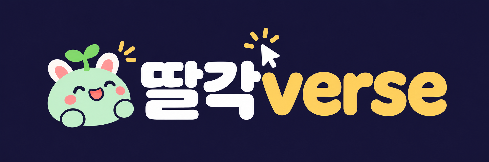

<p align="center"></p>
<p align="center"></p>

<p align="center"><b>A few chat messages and a few clicks (<i>ttalgak!</i>) — your own metaverse.</b><br/>Design the world together through a live interview, walk it with friends without a server, and publish it with one link.</p>
<p align="center"><a href="README.md">한국어</a> · English</p>

---

Start with one sentence: *"A Seoul walk metaverse — Hangang Park, Seokchon Lake and Gwanghwamun Square."*

While Claude asks you a few questions, **a draft of your world is drawn live in your browser**, then **three 3D mood/colour concepts** appear. Pick one and it becomes a world you can walk around, invite friends into, and publish at `https://<name>.workers.dev`.

- 🎙️ **Interview-driven worldbuilding** — not a fixed template; drafts grow with every answer
- 🔴 **Live preview** — world map and concept mockups update instantly in the browser (phone too); pick one with a button right on the board and Claude continues
- 👥 **Serverless multiplayer** — Supabase Realtime, people in the same zone see each other
- 🚀 **Free to publish** — Cloudflare Workers static assets, optional custom domain
- 🔐 **Always-on secret scanning** — keys, tokens and `.env` files are caught and filtered before every commit, push and deploy
- 🧭 **Resume anywhere** — a doctor skill finds where you left off and what's next

> The bundled example world "Seoul Walk" includes Gwanghwamun, the King Sejong & Admiral Yi statues, Lotte World Tower, Some Sevit islands, Banpo Bridge's rainbow fountain and N Seoul Tower. For real places, Claude looks up photos and matches their silhouettes.

> Distilled from building [Metrobus](https://metrobus.workromancer.ai), a Seoul Subway Line 2 metaverse.

## Install (Claude Code)

```
/plugin marketplace add workromancer/ttalgakverse
/plugin install ttalgakverse@ttalgakverse
```

In an empty folder, say **"I want to build a metaverse"** or run `/metaverse`. Claude replies in your language (Korean or English).

## Steps

You don't need slash commands — **just say it in chat** and Claude picks the right skill (or call one directly, e.g. `/metaverse`).

| | Just say | Skill | What it does |
|---|---|---|---|
| 0 | "I want to build a metaverse" | `metaverse` | Guide — checks progress and routes to the next step |
| 1 | "Am I ready?" | `mv-setup` | Node · **Supabase MCP** · **Cloudflare (wrangler)** checks and setup help |
| 2 | "Let's design the world" | `mv-worldview` | 🎙️ interview → 🔴 live world drafts (zone map, portals) → pick |
| 3 | "Let's pick the mood" | `mv-concept` | 🎙️ mood interview → 🔴 three live 3D concepts → pick or mix |
| 4 | "Build the world" | `mv-build` | Real world on a three.js engine, run locally (`npm run dev`) |
| 5 | "Let my friends join" | `mv-multiplayer` | Supabase project & keys; people in the same zone see each other |
| 6 | "Deploy it" | `mv-deploy` | Publish to `*.workers.dev` (+ custom domain, + private GitHub repo) |
| 🩺 | "I'm stuck", "where was I" | `mv-doctor` | Diagnose, fix, and continue projects started elsewhere |

## 🔐 Secret scanning (always on)

| When | How |
|---|---|
| Right before Claude runs `git commit`, `git push`, `gh repo create` or a deploy | Plugin hook scans and **blocks the command**, then Claude warns you and fixes it |
| When you commit/push yourself | The project's `.githooks/pre-commit` and `pre-push` run the same scan |
| `npm run deploy` | Scans the build output (`dist/`) before uploading |

Detects `.env`-style files, private keys/certificates, Supabase **service_role**/secret keys, Anthropic/OpenAI/GitHub/AWS/Slack/Telegram/Stripe/Cloudflare tokens, hard-coded passwords. Public keys (Supabase anon/publishable) are reported as fine. `secret-scan.mjs --fix` unstages risky files and adds them to `.gitignore`.

## Resume

Every step records to `.metaverse/state.json` (machine) and `.metaverse/PROGRESS.md` (human). Another day, machine or session — `/metaverse` picks up where you left off.

## Cost

Both Cloudflare Workers static assets and Supabase start on free plans. A custom domain is optional.

Documentation inside the skills is written in Korean; Claude follows it and talks to you in English if you write in English.

## License

[MIT](LICENSE)
