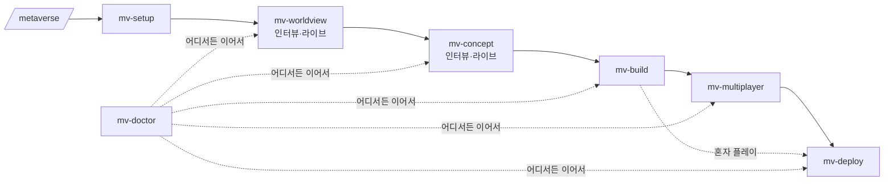

<p align="center"></p>
<p align="center"></p>

<p align="center"><b>채팅 몇 마디, 딸각 몇 번이면 나만의 메타버스.</b><br/>인터뷰하며 세계를 함께 그리고, 서버 없이 친구들과 걷고, 링크 하나로 공개까지.</p>
<p align="center">한국어 · <a href="README.en.md">English</a></p>

---

"한강공원이랑 석촌호수, 광화문광장을 걸어 다니는 서울 산책 메타버스 만들고 싶어" — 이 한 마디로 시작합니다.

Claude 가 몇 가지를 물어보는 동안, 브라우저 화면에서 **당신만의 세계관 초안이 실시간으로 그려지고**, 이어서 **분위기·색감 시안 3개가 3D 로** 나타납니다. 고르면 그대로 걸어 다닐 수 있는 월드가 되고, 친구와 같이 접속하고, `https://<이름>.workers.dev` 로 공개됩니다.

- 🎙️ **인터뷰로 만드는 세계** — 고정된 템플릿 고르기가 아니라, 답할 때마다 초안이 자랍니다
- 🔴 **라이브 미리보기** — 세계관 지도·컨셉 시안이 브라우저에서 바로바로 바뀜 (휴대폰으로도)
- 👥 **서버 없는 멀티플레이** — Supabase Realtime, 같은 구역 사람끼리 실시간
- 🚀 **무료로 공개** — Cloudflare Workers 정적 배포, 원하면 내 도메인
- 🔐 **비밀 정보 자동 검사** — 커밋·push·배포 직전마다 키·토큰·`.env` 를 찾아 막고 걸러 줌
- 🧭 **중간에 막혀도 이어서** — 진단 스킬이 어디까지 됐는지 보고 다음 단계로

> 서울 지하철 2호선 메타버스 [메트로버스](https://metrobus.workromancer.ai)를 만든 과정을 누구나 쓸 수 있게 정리했습니다.

## 설치 (Claude Code)

```
/plugin marketplace add workromancer/ttalgakverse
/plugin install ttalgakverse@ttalgakverse
```

빈 폴더에서 **"메타버스 만들고 싶어"** 라고 입력하거나 `/metaverse` 를 실행하세요.

## 진행 단계

| | 스킬 | 하는 일 |
|---|---|---|
| 0 | `/metaverse` | 길잡이 — 지금 어디까지 왔는지 보고 다음 단계로 |
| 1 | `/mv-setup` | Node · **Supabase MCP** · **Cloudflare(wrangler)** 준비 확인과 설정 안내 |
| 2 | `/mv-worldview` | 🎙️ 인터뷰 → 🔴 세계관 초안(구역 지도·포털)을 라이브로 → 고르기 |
| 3 | `/mv-concept` | 🎙️ 분위기 인터뷰 → 🔴 3D 컨셉 시안 3개를 라이브로 → 고르기·섞기 |
| 4 | `/mv-build` | three.js 엔진으로 실제 월드, 로컬 실행 (`npm run dev`) |
| 5 | `/mv-multiplayer` | Supabase 프로젝트·키 설정, 같은 구역 사람끼리 보이게 |
| 6 | `/mv-deploy` | `*.workers.dev` 공개 (+ 내 도메인, + GitHub private 저장소) |
| 🩺 | `/mv-doctor` | 막혔을 때 진단·처방, 다른 데서 하다 온 프로젝트 이어가기 |



## 🔴 라이브 미리보기

인터뷰를 시작하면 Claude 가 `http://localhost:4321/` 에 미리보기 서버를 띄웁니다. 답할 때마다 화면이 저절로 새로고침되며 초안이 바뀝니다.

| 세계관 보드 `/worlds/` | 컨셉 보드 `/concepts/` |
|---|---|
| 인터뷰 답 · 초안별 구역 지도 · 포털 연결 · 할 일 | 같은 구역을 세 가지 분위기의 3D 로 · 색 팔레트 · UI 샘플 |

## 🔐 비밀 정보 검사 (항상 켜짐)

| 언제 | 어떻게 |
|---|---|
| Claude 가 `git commit` · `git push` · `gh repo create` · 배포 명령을 실행하기 직전 | 플러그인 훅이 검사, 문제 있으면 **명령을 멈추고** 사용자에게 경고·처리 |
| Claude 밖에서 직접 커밋·push 할 때 | 프로젝트의 `.githooks/pre-commit` · `pre-push` 가 같은 검사 |
| `npm run deploy` | 빌드 결과(`dist/`)에 비밀 키가 섞였는지 검사 후 배포 |

찾는 것: `.env` 류 파일, 개인키·인증서, Supabase **service_role**·secret 키, Anthropic·OpenAI·GitHub·AWS·Slack·Telegram·Stripe·Cloudflare 토큰, 코드에 적힌 비밀번호 등. (Supabase anon/publishable 키처럼 공개용 키는 "괜찮음"으로 안내)
걸러 주기: `secret-scan.mjs --fix` 가 위험한 파일을 커밋에서 빼고 `.gitignore` 에 추가합니다.

## 이어서 하기

모든 단계는 프로젝트의 `.metaverse/state.json`(기계용)과 `.metaverse/PROGRESS.md`(사람용)에 기록됩니다. 다른 날, 다른 컴퓨터, 다른 세션에서도 `/metaverse` 한 번이면 이어집니다.

```
$ node skills/mv-doctor/scripts/doctor.mjs ~/my-world
✅ mv-setup        node 22.11.0, npm 10.9.0
✅ mv-worldview    서울 산책 · 구역 3개
✅ mv-concept      선택: 서울의 노을
✅ mv-build        npm 패키지 설치됨
⬜ mv-multiplayer  .env 에 VITE_SUPABASE_URL/KEY 없음 (없어도 혼자 플레이는 됨)
⬜ mv-deploy       wrangler 이름 seoul-walk, 아직 배포 기록 없음

👉 다음 단계: /mv-multiplayer
```

## 만들어지는 월드 (템플릿 엔진)

- 구역마다 바닥 무늬·물·그림자·도시 불빛과 빛나는 포털
- 소품 30여 종 — 벚나무·한옥·가게부터 **광화문·세종대왕/이순신 동상·롯데월드타워·세빛섬·반포대교 무지개분수·남산타워** 같은 서울 랜드마크까지 (예시 월드 "서울 산책")
- 실제 장소를 원하면 Claude 가 사진을 찾아보고 특징을 맞춰 새 소품을 만듦
- 동글동글 아바타 · 이모트 · 닉네임 · 이름표 (월드 색)
- WASD · 달리기 · 점프 · 드래그 시점 · 바닥 탭 이동 · 휴대폰 조이스틱
- `world/world.json`(구역) + `world/concept.json`(색·빛) 두 파일만 바꾸면 다른 세계

## 비용

Cloudflare Workers 정적 자산·Supabase 모두 무료 요금제로 시작할 수 있습니다. 도메인은 선택.

## 구조

```
.claude-plugin/   플러그인·마켓플레이스 정보
hooks/            항상 켜진 비밀 정보 검사 훅
shared/           secret-scan.mjs · secret-guard.mjs · live-preview.mjs
skills/           metaverse · mv-setup · mv-worldview · mv-concept · mv-build · mv-multiplayer · mv-deploy · mv-doctor
docs/             워크플로우 설계, 상태·스키마 형식
examples/         컨셉 시안 예시
```
