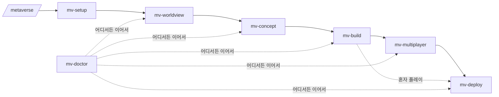

# 🌏 metaverse-kit

**서버 없이, 누구나, 원하는 분위기로** 브라우저 3D 메타버스를 만들고 공개하는 Claude Code 스킬 묶음.

"별빛이 내려앉는 정원 마을을 만들고 싶어" 한 마디에서 시작해 → 세계관을 정하고 → **컨셉 시안 3개를 HTML 로 보고 고르고** → 실제 3D 월드를 만들고 → 친구들과 같이 걷게(멀티플레이) 하고 → `https://<이름>.workers.dev` 로 공개하기까지, 단계마다 스킬이 안내합니다. 혼자 하다 막힌 프로젝트도 진단해서 이어갑니다.

> 서울 지하철 2호선 메타버스 [메트로버스](https://metrobus.workromancer.ai)를 만들면서 쓴 방법을 누구나 쓸 수 있게 정리했습니다.

## 설치

Claude Code 에서:

```
/plugin marketplace add <이 저장소 GitHub 주소>
/plugin install metaverse-kit@metaverse-kit
```

그다음 아무 빈 폴더에서 **"메타버스 만들고 싶어"** 라고 말하거나 `/metaverse` 를 실행하세요.

## 6단계

| | 스킬 | 하는 일 | 남는 것 |
|---|---|---|---|
| 0 | `/metaverse` | 길잡이: 지금 어디까지 왔는지 보고 다음 단계로 | |
| 1 | `/mv-setup` | Node·**Supabase MCP**·**Cloudflare(wrangler)** 준비 확인과 설정 안내 | |
| 2 | `/mv-worldview` | 세계관·구역·포털 정하기 (예시 6개 제공) | `world/world.json` |
| 3 | `/mv-concept` | 월드 **컨셉 시안 3개를 HTML 로** 만들어 나란히 비교 → 선택 | `concepts/*.html`, `world/concept.json` |
| 4 | `/mv-build` | three.js 템플릿 엔진으로 실제 월드, 로컬 실행 | `src/` |
| 5 | `/mv-multiplayer` | Supabase Realtime 으로 같은 구역 사람끼리 보이게 | `.env`, DB 함수 |
| 6 | `/mv-deploy` | Cloudflare Workers 정적 배포 → `*.workers.dev` (원하면 내 도메인) | 공개 URL |
| 🩺 | `/mv-doctor` | 막혔을 때 진단·처방, 다른 데서 하다 온 프로젝트 이어가기 | |



자세한 설계: [docs/workflow.md](docs/workflow.md)

## 이어서 하기

모든 단계는 프로젝트 폴더의 `.metaverse/state.json`(기계용)과 `.metaverse/PROGRESS.md`(사람용)에 기록을 남깁니다. 다른 날, 다른 컴퓨터, 다른 AI 세션에서도 `/metaverse` 한 번이면 이어집니다.

```
$ node skills/mv-doctor/scripts/doctor.mjs ~/my-world
✅ mv-setup        node 22.11.0, npm 10.9.0
✅ mv-worldview    별빛 정원 · 구역 3개
✅ mv-concept      선택: 파스텔 밤하늘
✅ mv-build        npm 패키지 설치됨
⬜ mv-multiplayer  .env 에 VITE_SUPABASE_URL/KEY 없음 (없어도 혼자 플레이는 됨)
⬜ mv-deploy       wrangler 이름 starlight, 아직 배포 기록 없음

👉 다음 단계: /mv-multiplayer
```

## 무엇이 만들어지나 (템플릿 엔진)

- 구역(zone)마다 바닥·벽·소품(`tree bench lamp sign box rock flowers fountain kiosk`)·빛나는 **포털**
- 동글동글 아바타, 이모트(👋❤️🎉), 닉네임, 이름표
- WASD·달리기·점프·드래그 시점·바닥 탭 이동, 휴대폰 조이스틱
- 멀티플레이: 같은 구역 사람끼리 위치·방향·이모트 실시간 (Supabase Presence·Broadcast, 서버 코드 없음)
- 색·빛·하늘은 `concept.json`, 구역·소품은 `world.json` 만 바꾸면 다른 세계

## 예시

`examples/starlight/concepts/index.html` — 같은 광장을 세 가지 분위기(파스텔 밤하늘 · 한낮의 여름 정원 · 네온 야시장)로 그린 시안. 브라우저로 바로 열립니다.

## 비용

- Cloudflare Workers 정적 자산: 무료 요금제로 충분
- Supabase: 무료 요금제 (동시 접속 수백 명 수준까지)
- 도메인은 선택 (없으면 `*.workers.dev`)

## 저장소 구조

```
.claude-plugin/        플러그인·마켓플레이스 정보
skills/
  metaverse/           길잡이 (입구)
  mv-setup/            1 준비
  mv-worldview/        2 세계관 (+ 예시, world.json 검사기)
  mv-concept/          3 시안 (+ HTML 시안 틀, 생성 스크립트)
  mv-build/            4 빌드 (+ template/ 엔진)
  mv-multiplayer/      5 멀티플레이 (+ sql/)
  mv-deploy/           6 배포
  mv-doctor/           진단 (+ doctor.mjs)
docs/                  워크플로우 설계, 상태·스키마 형식
examples/              시안 예시
```
