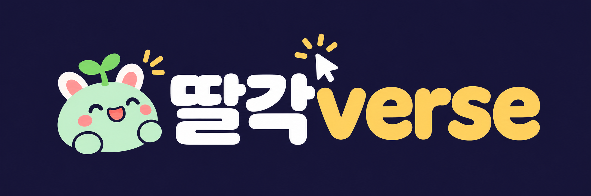
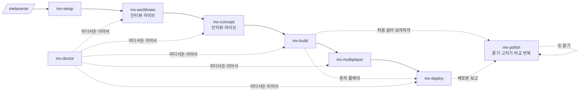

<p align="center"></p>
<p align="center"></p>

<p align="center"><b>채팅 몇 마디, 딸각 몇 번이면 나만의 메타버스.</b><br/>인터뷰하며 세계를 함께 그리고, 서버 없이 친구들과 걷고, 링크 하나로 공개까지.</p>
<p align="center">한국어 · <a href="README.en.md">English</a></p>
<p align="center">Claude Code · Codex (ChatGPT 앱) 호환</p>

---

"한강공원이랑 석촌호수, 광화문광장을 걸어 다니는 서울 산책 메타버스 만들고 싶어" — 이 한 마디로 시작합니다.

Claude 가 몇 가지를 물어보는 동안, 브라우저 화면에서 **당신만의 세계관 초안이 실시간으로 그려지고**, 이어서 **분위기·색감 시안 3개가 3D 로** 나타납니다. 고르면 그대로 걸어 다닐 수 있는 월드가 되고, 친구와 같이 접속하고, `https://<이름>.workers.dev` 로 공개됩니다.

- 🎙️ **인터뷰로 만드는 세계** — 고정된 템플릿 고르기가 아니라, 답할 때마다 초안이 자랍니다
- 🧸 **말한 그대로 새로 짓기** — 캐릭터·건물·구역 연출을 목록에서 고르지 않아요. "목도리 두른 펭귄", "구름 위 도서관", "벚꽃 흩날리는 언덕" 이라고 말하면 Claude 가 그 세계만의 코드로 지어 줍니다 (엔진·배포 방식만 고정)
- 🔴 **라이브 미리보기** — 세계관 지도·컨셉 시안이 브라우저에서 바로바로 바뀜 (휴대폰으로도)
- 👥 **서버 없는 멀티플레이** — Supabase Realtime, 같은 구역 사람끼리 실시간
- 🚀 **무료로 공개** — Cloudflare Workers 정적 배포, 원하면 내 도메인
- 🔐 **비밀 정보 자동 검사** — 커밋·push·배포 직전마다 키·토큰·`.env` 를 찾아 막고 걸러 줌
- 🔁 **다 만들고 나서가 진짜 시작** — Claude 가 먼저 아쉬운 점을 짚어 묻고, 고치고, 전후 비교를 보여 주고 또 묻습니다. 걷다가 📝 버튼으로 🎯 건물을 콕 집어 "여기 안 닮았어" 해도 돼요
- 🧭 **중간에 막혀도 이어서** — 진단 스킬이 어디까지 됐는지 보고 다음 단계로

> 서울 지하철 2호선 메타버스 [메트로버스](https://metrobus.workromancer.ai)를 만든 과정을 누구나 쓸 수 있게 정리했습니다.

## 사용 방법 (영상)

| Claude Code 로 만들기 | ChatGPT (Codex) 로 만들기 |
|---|---|
| [](https://youtu.be/78r-6ocGgb0) | [](https://youtu.be/SA1Y8qC7CoE) |
| [youtu.be/78r-6ocGgb0](https://youtu.be/78r-6ocGgb0) | [youtu.be/SA1Y8qC7CoE](https://youtu.be/SA1Y8qC7CoE) |

> 썸네일을 누르면 유튜브에서 열려요.

## 설치

**Claude Code** 와 **Codex** (ChatGPT 앱 포함) 모두에서 쓸 수 있어요.

| | 설치 |
|---|---|
| **Claude Code** | `/plugin marketplace add workromancer/ttalgakverse` → `/plugin install ttalgakverse@ttalgakverse` |
| **Codex / ChatGPT 앱** | 플러그인 마켓플레이스에 `workromancer/ttalgakverse` 를 추가하고 딸각verse 를 설치 |

설치한 뒤 빈 폴더에서 **"메타버스 만들고 싶어"** 라고 입력하면 시작합니다. (Claude Code 는 `/metaverse` 로 직접 불러도 됨)

> MCP 연결(Supabase·Cloudflare)은 쓰는 앱의 MCP 설정 방식을 따릅니다. 스킬이 공식 문서를 보고 그 앱에 맞게 안내해 줘요.

## 진행 단계

슬래시 명령은 몰라도 돼요. 아래처럼 **그냥 채팅으로 말하면** Claude 가 알맞은 스킬을 알아서 씁니다. (`/metaverse` 처럼 직접 불러도 됨)

| | 이렇게 말하면 | 스킬 | 하는 일 |
|---|---|---|---|
| 0 | "메타버스 만들고 싶어" | `metaverse` | 길잡이 — 지금 어디까지 왔는지 보고 다음 단계로 |
| 1 | "준비됐는지 봐줘" | `mv-setup` | Node · **Supabase MCP** · **Cloudflare MCP**·wrangler 준비 — 공식 문서([Supabase](https://supabase.com/docs/guides/ai-tools/mcp) · [Cloudflare](https://developers.cloudflare.com/agents/model-context-protocol/cloudflare/servers-for-cloudflare/)) 기준, 브라우저 버튼만 누르면 됨 |
| 2 | "세계관 정하자" | `mv-worldview` | 🎙️ 인터뷰 → 🔴 세계관 초안(구역 지도·포털)을 라이브로 → 고르기 |
| 3 | "분위기 정하자", "캐릭터 정하자" | `mv-concept` | 🎙️ 분위기 인터뷰 → 🔴 3D 컨셉 시안 3개 → 고르기·섞기 → 🧸 말한 캐릭터를 새로 지어 걸어 다니는 후보로 보여 주기 |
| 4 | "월드 만들어 줘" | `mv-build` | three.js 엔진으로 실제 월드, 로컬 실행 (`npm run dev`) |
| 5 | "친구랑 같이 놀게 해 줘" | `mv-multiplayer` | Supabase 프로젝트·키 설정, 같은 구역 사람끼리 보이게 |
| 6 | "배포해 줘" | `mv-deploy` | `*.workers.dev` 공개 (+ 내 도메인, + GitHub private 저장소) |
| 🔁 | "마음에 안 들어", "건물이 안 닮았어", "다듬자" | `mv-polish` | 다 만든 뒤 반복 다듬기 — 아쉬운 점을 먼저 짚어 묻기 → 고치기 → 전후 비교 → 또 묻기. 구조물은 사진 비교 작업대로 |
| 🩺 | "막혔어", "어디까지 했지" | `mv-doctor` | 막혔을 때 진단·처방, 다른 데서 하다 온 프로젝트 이어가기 |



## 🔴 라이브 미리보기

인터뷰를 시작하면 Claude 가 `http://localhost:4321/` 에 미리보기 서버를 띄웁니다. 답할 때마다 화면이 저절로 새로고침되며 초안이 바뀝니다.
마음에 드는 초안·시안은 **브라우저에서 「이걸로 할게요」 버튼을 누르면** Claude 가 바로 받아서 다음으로 넘어가요 (고칠 점도 같이 적을 수 있음). 채팅으로 골라도 됩니다.

| 세계관 보드 `/worlds/` | 컨셉 보드 `/concepts/` | 캐릭터 보드 `/avatars/` |
|---|---|---|
| 인터뷰 답 · 초안별 구역 지도 · 포털 연결 · 새로 지을 것 | 같은 구역을 세 가지 분위기의 3D 로 · 색 팔레트 · UI 샘플 | 말한 캐릭터를 새로 지은 후보들이 걷고 손 흔드는 모습 |

## 🧸 고정된 건 기술 스택뿐

| 고정 | 새로 짓기 (그 프로젝트 전용, 파일만 넣으면 엔진이 불러옴) |
|---|---|
| three.js + Vite 엔진, `world.json`·`concept.json` 형식, Supabase 멀티플레이, Cloudflare 배포, 비밀 정보 검사 | `src/avatars/` 캐릭터 · `src/props/` 건물·소품 · `src/scenes/` 지형·날씨·빛 연출 |

템플릿에 들어 있는 토끼 캐릭터와 서울 랜드마크는 **메뉴가 아니라 예시**예요. 자세한 규칙: [docs/custom-code.md](docs/custom-code.md)

## 🔁 다듬기 루프

처음 만든 월드는 대개 "나쁘진 않은데 뭔가 아쉬운" 상태입니다. 그런데 무엇이 아쉬운지 말로 꺼내기는 어렵죠. 그래서:

1. **Claude 가 먼저 봅니다** — 구역마다 스크린샷을 찍고 첫인상·구조물·볼거리·분위기·휴대폰 다섯 가지로 약점을 찾아요.
2. **구체적인 보기로 묻습니다** — "어때요?" 대신 "광화문 지붕이 실제보다 납작해요 / 한강 앞쪽이 휑해요 …" 중 고르기. 마음에 드는 것도 하나 물어서 그건 건드리지 않아요.
3. **고치고, 같은 자리·같은 각도로 전후 비교**를 보여 줍니다. 라운드마다 커밋해 두니 "아까가 나았어" 하면 되돌려요.
4. **또 묻습니다** — 다음으로 고칠 만한 것 2~3개와 "이대로 좋아요" 중에서. 만족하면 끝.

| 📝 월드 안 「고칠 점」 버튼 | 🛠️ 구조물 작업대 `/lab.html` |
|---|---|
| 걷다가 누르고 한 줄 쓰면 화면·위치와 함께 Claude 에게. **🎯 콕 집기**로 건물을 탭하면 world.json 의 어느 소품인지·실제 크기까지 같이 가요 ("너무 커요", "진짜랑 안 닮았어요" 같은 보기 제공) | 구조물 하나를 정면·45°·옆·위 네 방향 + 사람 크기 비교 + 참고 사진을 한 화면에. Claude 가 고칠 때마다 이 화면으로 사진과 비교해요 |

둘 다 `npm run dev` 에서만 보이고 배포본에는 들어가지 않습니다.

## 🔐 비밀 정보 검사 (항상 켜짐)

| 언제 | 어떻게 |
|---|---|
| Claude 가 `git commit` · `git push` · `gh repo create` · 배포 명령을 실행하기 직전 | 플러그인 훅이 검사, 문제 있으면 **명령을 멈추고** 사용자에게 경고·처리 |
| Claude 밖에서 직접 커밋·push 할 때 | 프로젝트의 `.githooks/pre-commit` · `pre-push` 가 같은 검사 |
| `npm run deploy` | 빌드 결과(`dist/`)에 비밀 키가 섞였는지 검사 후 배포 |

찾는 것: `.env` 류 파일, 개인키·인증서, Supabase **service_role**·secret 키, Anthropic·OpenAI·GitHub·AWS·Slack·Telegram·Stripe·Cloudflare 토큰, 코드에 적힌 비밀번호 등. (Supabase anon/publishable 키처럼 공개용 키는 "괜찮음"으로 안내)
걸러 주기: `secret-scan.mjs --fix` 가 위험한 파일을 커밋에서 빼고 `.gitignore` 에 추가합니다.

## 이어서 하기

모든 단계는 프로젝트의 `.metaverse/state.json`(기계용)과 `.metaverse/PROGRESS.md`(사람용)에 기록됩니다. 다른 날, 다른 컴퓨터, 다른 세션에서도 `/metaverse` 한 번이면 이어집니다.

```
$ node skills/mv-doctor/scripts/doctor.mjs ~/my-world
✅ mv-setup        node 22.11.0, npm 10.9.0
✅ mv-worldview    서울 산책 · 구역 3개
✅ mv-concept      선택: 서울의 노을
✅ mv-build        npm 패키지 설치됨
⬜ mv-multiplayer  .env 에 VITE_SUPABASE_URL/KEY 없음 (없어도 혼자 플레이는 됨)
⬜ mv-deploy       wrangler 이름 seoul-walk, 아직 배포 기록 없음

👉 다음 단계: mv-multiplayer — "친구랑 같이 놀게 해 줘" 라고 말하면 돼요
```

## 만들어지는 월드 (템플릿 엔진)

- 구역마다 바닥 무늬·물·그림자·도시 불빛과 빛나는 포털
- 소품 30여 종 — 벚나무·한옥·가게부터 **광화문·세종대왕/이순신 동상·롯데월드타워·세빛섬·반포대교 무지개분수·남산타워** 같은 서울 랜드마크까지 (예시 월드 "서울 산책")
- 실제 장소를 원하면 Claude 가 사진을 찾아보고 특징을 맞춰 새 소품을 만듦
- 동글동글 아바타 · 이모트 · 닉네임 · 이름표 (월드 색)
- WASD · 달리기 · 점프 · 드래그 시점 · 바닥 탭 이동 · 휴대폰 조이스틱
- `world/world.json`(구역) + `world/concept.json`(색·빛) 두 파일만 바꾸면 다른 세계

## 비용

Cloudflare Workers 정적 자산·Supabase 모두 무료 요금제로 시작할 수 있습니다. 도메인은 선택.

## 구조

```
.claude-plugin/   플러그인·마켓플레이스 정보
hooks/            항상 켜진 비밀 정보 검사 훅
shared/           secret-scan.mjs · secret-guard.mjs · live-preview.mjs
skills/           metaverse · mv-setup · mv-worldview · mv-concept · mv-build · mv-multiplayer · mv-deploy · mv-doctor
docs/             워크플로우 설계, 상태·스키마 형식
examples/         컨셉 시안 예시
```

## 라이선스

[MIT](LICENSE) — 자유롭게 쓰고, 고치고, 나눠도 됩니다.
