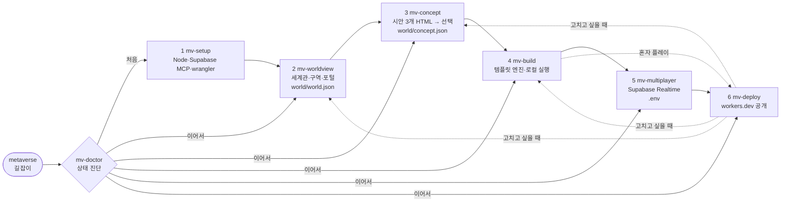

# 워크플로우 설계

## 한눈에

## 설계 원칙

1. **단계마다 결과물이 파일 하나로 남는다** — 세계관은 `world/world.json`, 분위기는 `world/concept.json`. 엔진 코드는 이 두 파일만 읽으므로, 단계를 다시 해도 앞뒤가 깨지지 않는다.
2. **상태는 두 곳에** — 기계용 `.metaverse/state.json`, 사람용 `.metaverse/PROGRESS.md`. 다른 사람·다른 AI 세션이 이것만 보고 이어간다.
3. **진단은 실제 파일 기준** — `mv-doctor` 가 상태 파일을 믿지 않고 파일·설정·네트워크를 직접 확인해 상태를 고쳐 쓴다. 그래서 손으로 만들다 온 프로젝트도 이어갈 수 있다.
4. **보고 고른다** — 분위기는 말보다 시안. 시안은 엔진과 같은 소품·색 규칙으로 그려서 "고른 게 그대로 나온다".
5. **서버 없음, 비용 0 에서 시작** — 정적 배포(Cloudflare Workers assets) + Supabase 무료. 키는 공개용(publishable)만 브라우저에.
6. **외부에 영향 주는 일은 확인 후** — DB 변경, 배포, 도메인 연결은 한 줄 확인을 받는다.

## 단계별 입출력

| 단계 | 읽는 것 | 쓰는 것 | 완료 판정 (doctor) |
|---|---|---|---|
| setup | — | state.steps.setup | Node ≥18, npm |
| worldview | 사용자 답 | world/world.json | slug·zones 있음 |
| concept | world.json | concepts/*.html, world/concept.json | concept.json 에 palette |
| build | world/*.json | src/, package.json, node_modules | 템플릿 + 설치 |
| multiplayer | — | .env, Supabase 함수 | server_time RPC 응답 |
| deploy | dist | state.deploy.url | URL 이 200 |
